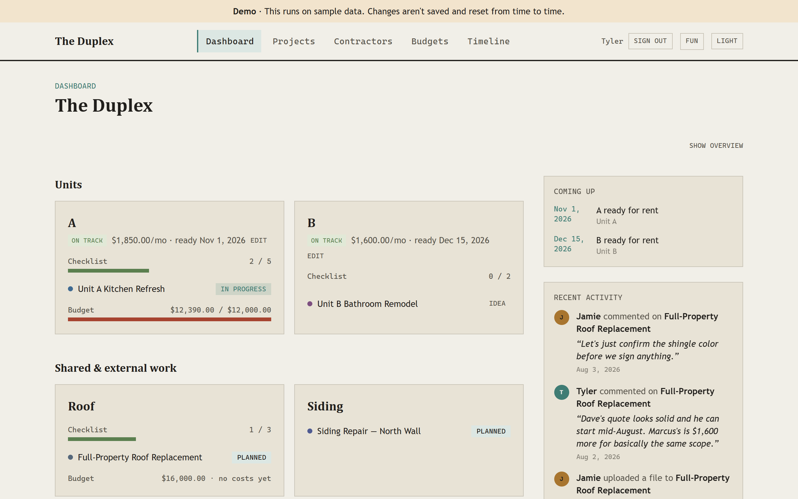

# The Duplex

[](https://github.com/TylerJayIves/duplex-tracker/actions/workflows/test.yml)

A renovation and rental tracker for a two-unit duplex. It keeps every project, checklist, cost, contractor quote and budget in one place, and the dashboard flags what needs attention before it turns into a problem.

## Why I built it

My wife and I are renovating a duplex and getting both units ready to rent, and the to-do list quickly became unmanageable. Tools like Jira didn't fit: they're built for software teams, not for tracking contractor quotes, costs against a budget, and which unit is ready when. So I built something that did, where the two of us can see everything in one place. It's what we use day to day.

We're completely new to renovating, and it gets more complex by the week, so I keep expanding the app as new needs come up.

**[Try the live demo →](https://duplex-tracker-demo.vercel.app/)**
No account needed. It runs on sample data and resets from time to time.

## Screenshots

| Dashboard                                    | Project page                                  |
| -------------------------------------------- | --------------------------------------------- |
|  |  |

| The "fun" layout                        |
| --------------------------------------- |
|  |

## Features

- **Dashboard** with a "Needs attention" list: over-budget items, overdue tasks, and contractor quotes that need a decision or are about to expire
- **Projects** per unit or shared area, with status, priority, target dates, a checklist, comments and file attachments
- **Costs and budgets**: estimated vs. actual line items, plus budget caps per unit or project with a health indicator
- **Contractors and quotes**: a contractor roster, quotes per project and follow-up reminders
- **Timeline** of what's scheduled and what's coming up
- Username and password sign-in for the two of us, with no email involved
- Two layouts (classic and "fun"), plus light and dark mode

## Tech stack

- **Next.js 16** (App Router, Server Components, Server Actions) with **React 19** and **TypeScript**
- **Supabase**: Postgres, Auth and Storage.
- **Tailwind CSS 4** and shadcn/ui components
- **Vitest** for unit tests, with **GitHub Actions** running them on every pull request
- Deployed on **Vercel**: one deployment for the real app, and a second one for the demo

## Testing

```bash
npm run test       # watch mode
npm run test:run   # run once (what CI runs)
```

The tests cover money parsing and formatting, date handling (including the time-zone and daylight-saving edge cases), budget health, the dashboard rules, and the sign-in helpers. Writing them turned up a few real bugs. The biggest was in `safeNext`, the redirect check after login: it let `/\t/evil.com` through, because browsers strip the tab and read the result as `//evil.com`. It's fixed now, with tests for that and similar tricks.

## Project structure

```
src/
  app/            Pages (App Router): dashboard, projects, contractors, budgets, timeline, account, login
  components/     UI components, grouped by feature
  lib/
    actions/      Server actions (forms, uploads, sign-in)
    auth/         Current user, safe redirects, sign-in messages
    data/         DataClient interface, plus the mock and Supabase implementations
    domain/       Business rules for the dashboard and budgets (pure functions and tests)
supabase/
  migrations/     Schema, RLS policies and constraints
  seed.sql        Local sample data
```
